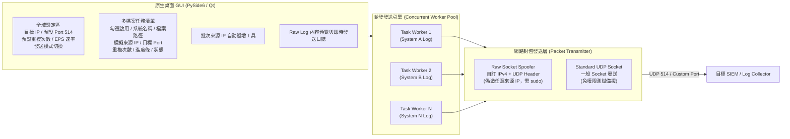

# Multi-Source Raw Log UDP 發送模擬器 — 系統設計與實作計畫

透過先前的需求對談，我們已確認完整的系統規格與架構設計。以下為系統實作方案內容：

---

## 1. 核心架構與技術選型

- **開發語言與環境**：Python 3 + `PySide6`（Qt6 原生跨平台桌面 GUI，支援 macOS、Linux，未來可直接相容 Windows）。
- **並發機制**：採用獨立執行緒 Worker，支援**同時並發發送多個 Raw Log 檔案**，互不阻塞 UI，且可隨時單獨或全部「開始 / 暫停 / 停止」。

---

## 2. 功能模組規格

### A. 網路封包與來源 IP 模擬 (`core/packet_sender.py`)
1. **Raw Socket 偽造模式（預設，支援任意跨網段 Source IP）**：
   - 手動封裝完整 **IPv4 Header (20 bytes)** 與 **UDP Header (8 bytes)**（含正確計算 IPv4 與 UDP Pseudo-header Checksum）。
   - 相容 **macOS (`BSD` Raw Socket 規範)** 與 **Linux (`IP_HDRINCL`)** 的核心差異（例如 macOS `ip_len` / `ip_off` host byte order 處理），不需依賴龐大的外部封包擷取驅動即可輕量發送。
   - 啟動時自動檢測是否具備 `root / sudo` 權限，並在介面狀態列清楚標示。
2. **一般 UDP Socket 備援模式（免 `sudo` 測試模式）**：
   - 當未以 `sudo` 啟動或使用者切換至「一般 Socket 模式」時，使用標準 `socket.AF_INET, socket.SOCK_DGRAM` 發送，方便在本機無管理員權限時快速測試流程與本機接收。
3. **選配 Syslog Header 包裝**：
   - 預設**逐行原樣發送**（忽略空白行）。
   - 可勾選「自動補上標準 RFC3164 Syslog Header (`<PRI>Timestamp SourceIP/Host Message`)」。

### B. 多任務設定與發送控制 (`core/models.py` & `core/worker.py`)
- **全域預設值**：
  - 目標伺服器 IP（Destination IP，例如 `127.0.0.1` 或 SIEM IP）
  - 預設目標 Port（預設 `514`）
  - 預設重複發送次數（`1 ~ N` 次，或勾選「無限循環發送直到手動停止」）
  - 預設每輪間隔秒數（Loop Interval，例如 `1.0` 秒）
  - 預設發送速率（EPS 每秒筆數限制，例如 `100 EPS` 或 `0 = 不限速全速發送`）
- **個別 Raw Log 檔案設定（支援覆寫全域設定）**：
  - 每個檔案為一列任務，包含：
    - 啟用勾選、檔案名稱（系統識別名稱）、總行數統計
    - **模擬來源 IP (Source IP)**（必填，每個檔案不同）
    - **目標 Port**（預設繼承全域 `514`，可個別改為如 `1514`, `5514` 等）
    - **重複次數 / EPS 速率**（預設繼承全域，可個別覆寫）
    - **即時狀態顯示**：目前輪數（如 `第 2 / 5 輪`）、已發送筆數、進度條 (`%`)、發送狀態。
- **批次來源 IP 自動分配器**：
  - 輸入起始 IP（例如 `192.168.10.101`），一鍵為清單中所有 Raw Log 自動遞增填入 `192.168.10.101`, `192.168.10.102`, `192.168.10.103`...。

### C. 圖形化介面與輔助工具 (`ui/main_window.py`)
- **檔案管理**：支援多選匯入 `.log` / `.txt` / `.raw` 檔案，或整個資料夾批次匯入。
- **Raw Log 預覽面板**：點選清單中任一檔案，下方可即時預覽前 100 行 Raw Log 內容與編碼狀態。
- **設定檔儲存與載入 (JSON Profile)**：可將目前所有檔案清單、對應 Source IP、Port 與速率設定匯出成 `.json` 設定檔，下次一鍵載入。
- **內建簡易本機 UDP 測試接收監聽器**：方便在沒有外部 SIEM 時，直接在本機監聽指定 Port（如 `5514` 或 `514`）驗證封包是否成功送出。

---

## 3. 專案目錄結構與範例檔案

- `PLAN.md` — 本系統架構與設計規劃文件
- `main.py` — 程式進入點與 GUI 啟動腳本
- `core/`
  - `__init__.py`
  - `models.py` — 任務設定與全域設定資料結構（支援 JSON 序列化）
  - `packet_sender.py` — 跨平台 (macOS/Linux/Windows fallback) Raw Socket IPv4/UDP 封包構造器與一般 UDP Socket 發送器
  - `worker.py` — 多執行緒非同步發送 Worker 與內建本機 UDP 測試接收監聽器
- `ui/`
  - `__init__.py`
  - `main_window.py` — PySide6 主視窗、任務表格、批次 IP 設定對話框、預覽與即時 Log 面板
- `sample_logs/` — 預先內建 4 個不同系統的真實感範例 Raw Log 檔案供立即測試：
  1. `firewall_paloalto.log`（防火牆流量與威脅日誌）
  2. `linux_sshd_auth.log`（Linux 伺服器認證與登入日誌）
  3. `windows_security_event.log`（Windows 安全事件日誌）
  4. `nginx_web_access.log`（Web 伺服器存取日誌）
- `default_profile.json` — 預設範例設定檔（啟動時自動載入 4 個範例檔案與不同 Source IP）
- `run.sh` / `run_sudo.sh` — 快速啟動腳本（一般啟動與 `sudo` Raw Socket 模式啟動）
- `requirements.txt` & `README.md` — 環境依賴與操作說明
