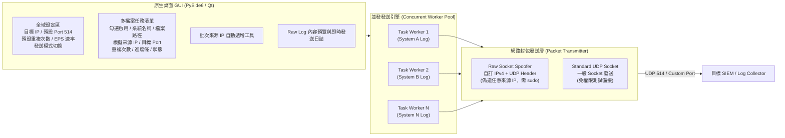

# Multi-Source Raw Log UDP 發送模擬器 — 系統設計與實作計畫

透過先前的需求對談，我們已確認完整的系統規格與架構設計。以下為系統實作方案內容：

---

## 1. 核心架構與技術選型

- **開發語言與環境**：Python 3 + `PySide6`（Qt6 原生跨平台桌面 GUI，支援 macOS、Linux，未來可直接相容 Windows）。
- **並發機制**：採用獨立執行緒 Worker，支援**同時並發發送多個 Raw Log 檔案**，互不阻塞 UI，且可隨時單獨或全部「開始 / 暫停 / 停止」。

---

## 2. 功能模組規格

### A. 網路封包與來源 IP 模擬 (`core/packet_sender.py`)
1. **Raw Socket 偽造模式（預設，支援任意跨網段 Source IP）**：
   - 手動封裝完整 **IPv4 Header (20 bytes)** 與 **UDP Header (8 bytes)**（含正確計算 IPv4 與 UDP Pseudo-header Checksum）。
   - 相容 **macOS (`BSD` Raw Socket 規範)** 與 **Linux (`IP_HDRINCL`)** 的核心差異（例如 macOS `ip_len` / `ip_off` host byte order 處理），不需依賴龐大的外部封包擷取驅動即可輕量發送。
   - 啟動時自動檢測是否具備 `root / sudo` 權限，並在介面狀態列清楚標示。
2. **一般 UDP Socket 備援模式（免 `sudo` 測試模式）**：
   - 當未以 `sudo` 啟動或使用者切換至「一般 Socket 模式」時，使用標準 `socket.AF_INET, socket.SOCK_DGRAM` 發送，方便在本機無管理員權限時快速測試流程與本機接收。
3. **選配 Syslog Header 包裝**：
   - 預設**逐行原樣發送**（忽略空白行）。
   - 可勾選「自動補上標準 RFC3164 Syslog Header (`<PRI>Timestamp SourceIP/Host Message`)」。

### B. 多任務設定與發送控制 (`core/models.py` & `core/worker.py`)
- **全域預設值**：
  - 目標伺服器 IP（Destination IP，例如 `127.0.0.1` 或 SIEM IP）
  - 預設目標 Port（預設 `514`）
  - 預設重複發送次數（`1 ~ N` 次，或勾選「無限循環發送直到手動停止」）
  - 預設每輪間隔秒數（Loop Interval，例如 `1.0` 秒）
  - 預設發送速率（EPS 每秒筆數限制，例如 `100 EPS` 或 `0 = 不限速全速發送`）
- **個別 Raw Log 檔案設定（支援覆寫全域設定）**：
  - 每個檔案為一列任務，包含：
    - 啟用勾選、檔案名稱（系統識別名稱）、總行數統計
    - **模擬來源 IP (Source IP)**（必填，每個檔案不同）
    - **目標 Port**（預設繼承全域 `514`，可個別改為如 `1514`, `5514` 等）
    - **重複次數 / EPS 速率**（預設繼承全域，可個別覆寫）
    - **即時狀態顯示**：目前輪數（如 `第 2 / 5 輪`）、已發送筆數、進度條 (`%`)、發送狀態。
- **批次來源 IP 自動分配器**：
  - 輸入起始 IP（例如 `192.168.10.101`），一鍵為清單中所有 Raw Log 自動遞增填入 `192.168.10.101`, `192.168.10.102`, `192.168.10.103`...。

### C. 圖形化介面與輔助工具 (`ui/main_window.py`)
- **檔案管理**：支援多選匯入 `.log` / `.txt` / `.raw` 檔案，或整個資料夾批次匯入。
- **Raw Log 預覽面板**：點選清單中任一檔案，下方可即時預覽前 100 行 Raw Log 內容與編碼狀態。
- **設定檔儲存與載入 (JSON Profile)**：可將目前所有檔案清單、對應 Source IP、Port 與速率設定匯出成 `.json` 設定檔，下次一鍵載入。
- **內建簡易本機 UDP 測試接收監聽器**：方便在沒有外部 SIEM 時，直接在本機監聽指定 Port（如 `5514` 或 `514`）驗證封包是否成功送出。

---

## 3. 專案目錄結構與範例檔案

- `PLAN.md` — 本系統架構與設計規劃文件
- `main.py` — 程式進入點與 GUI 啟動腳本
- `core/`
  - `__init__.py`
  - `models.py` — 任務設定與全域設定資料結構（支援 JSON 序列化）
  - `packet_sender.py` — 跨平台 (macOS/Linux/Windows fallback) Raw Socket IPv4/UDP 封包構造器與一般 UDP Socket 發送器
  - `worker.py` — 多執行緒非同步發送 Worker 與內建本機 UDP 測試接收監聽器
- `ui/`
  - `__init__.py`
  - `main_window.py` — PySide6 主視窗、任務表格、批次 IP 設定對話框、預覽與即時 Log 面板
- `sample_logs/` — 預先內建 4 個不同系統的真實感範例 Raw Log 檔案供立即測試：
  1. `firewall_paloalto.log`（防火牆流量與威脅日誌）
  2. `linux_sshd_auth.log`（Linux 伺服器認證與登入日誌）
  3. `windows_security_event.log`（Windows 安全事件日誌）
  4. `nginx_web_access.log`（Web 伺服器存取日誌）
- `default_profile.json` — 預設範例設定檔（啟動時自動載入 4 個範例檔案與不同 Source IP）
- `run.sh` / `run_sudo.sh` — 快速啟動腳本（一般啟動與 `sudo` Raw Socket 模式啟動）
- `requirements.txt` & `README.md` — 環境依賴與操作說明

---

# 第二版 (v2.0) — 轉型為「零第三方依賴」跨平台 Web 介面架構

## 1. 改動原因（為什麼從原生桌面 `PySide6` 改為 Web 介面？）

在第一版 (`v1.0`，已提交至 Git `184adf5`) 的實務部署與跨平台測試（macOS 與 Ubuntu Linux VM）過程中，我們發現 `PySide6 (Qt6)` 桌面視窗在面對本專案核心需求時存在以下結構性限制：

1. **`sudo` 管理員權限與桌面圖形系統 (Wayland / X11) 的嚴重衝突**：
   - 本工具的核心功能（「網卡掛載虛擬副 IP `ifconfig`/`ip addr`」與「Raw Socket 封包偽造」）**必須以 `sudo` / `root` 權限執行**。
   - 在 Ubuntu (Wayland / X11) 環境下，以 `sudo` 執行桌面 GUI 時，作業系統安全機制會清空 `XDG_RUNTIME_DIR` 與 `WAYLAND_DISPLAY` 等環境變數，導致 Qt 被迫降級至 X11 (`xcb`) 外掛，進而因為缺少系統底層圖形庫 (`libxcb-cursor0`) 或 Xauthority 授權問題而直接崩潰 (`Aborted / core dumped`)。
2. **龐大的安裝體積與系統相依性**：
   - `PySide6` 安裝體積高達 **450 MB 以上**，且在不同 Linux 發行版上需要額外安裝多個 `libxcb-*` 系統套件；若在封閉內網或離線測試環境中部署極為不便。
3. **無法支援無桌面環境的 Linux 測試機 (Headless Server)**：
   - 實務上常需將 Log 發送端部署於無桌面環境的 Linux VM（僅透過 SSH 連線），原生桌面 GUI 無法在此類環境執行。

---

## 2. 第二版 (v2.0) 具體做法與架構設計

為徹底解決上述問題，第二版採用 **「Python 內建標準庫 Web Server (`ThreadingHTTPServer`) + 現代化單頁式 Web UI (SPA)」** 架構，達成 **「零第三方套件依賴 (Zero-Dependency)」**。

```mermaid
flowchart LR
    subgraph Browser["跨平台瀏覽器 Web UI (macOS / Linux / Windows / 遠端連線)"]
        WebGlobal["全域設定與網卡 IP Alias 管理面板"]
        WebTable["多檔案任務清單與即時進度條"]
        WebPicker["伺服器端檔案/資料夾選取器\n(原地讀取百 MB 大檔免上傳)"]
        WebTabs["即時發送日誌 / Raw Log 預覽 / 本機 UDP 接收測試器"]
    end

    subgraph Backend["Python 零依賴後端服務 (ThreadingHTTPServer, 支援 sudo)"]
        API["RESTful JSON API 控制器\n(/api/state, /api/start, /api/alias, /api/files...)"]
        TaskMgr["純 Python 多執行緒任務管理引擎\n(移除 Qt QThread 依賴，改用標準 threading)"]
        RecvMgr["本機 UDP 測試接收執行緒"]
    end

    subgraph Network["網路封包發送與網卡管理層 (完全保留 v1 核心)"]
        AliasBind["IP Alias 綁定發送\n(ifconfig / ip addr + socket.bind)"]
        RawSpoof["Raw Socket 偽造來源 IP\n(自訂 IPv4 + UDP Header)"]
        StdUDP["一般 UDP Socket 備援"]
    end

    Browser <-->|"HTTP JSON API (127.0.0.1:8080)"| API
    API --> TaskMgr & RecvMgr
    TaskMgr --> Network
    Network -->|"UDP 514 / Custom Port"| SIEM["目標 SIEM / Log Server"]
```

### 具體改造步驟：

1. **移除 `PySide6` 依賴，重構執行緒引擎 (`core/worker.py`)**：
   - 將原本繼承自 `PySide6.QtCore.QThread` 與 `Signal` 的 `LogTaskWorker` 與 `LocalUdpReceiverThread`，改為使用 Python 標準庫 `threading.Thread` 與執行緒安全 (`threading.Lock`) 的狀態儲存區 (`TaskManager`)。
   - **完整保留** `core/models.py`、`core/packet_sender.py` 與 `core/ip_alias_manager.py` 的所有底層能力（包含網卡虛擬副 IP 掛載/卸載、Raw Socket 偽造、EPS 速率控制、重複發送與無限循環）。

2. **建立內建輕量 Web Server 與 REST API (`web/server.py`)**：
   - 使用 Python 標準庫 `http.server.ThreadingHTTPServer` 建立高效能多執行緒 Web 伺服器（預設監聽 `http://0.0.0.0:8080`，支援本機自動開啟瀏覽器，也支援從其他電腦遠端連線操作）。
   - 提供完整 API：
     - `GET /api/status`：取得全系統即時狀態（Root 權限狀態、網卡列表、各任務進度百分比、已送筆數、執行日誌、本機 UDP 接收器訊息）。
     - `POST /api/tasks/start`、`POST /api/tasks/pause`、`POST /api/tasks/stop`：控制多任務並發發送、暫停與停止。
     - `POST /api/alias/mount`、`POST /api/alias/unmount`：一鍵掛載與清除網卡虛擬副 IP (IP Alias)。
     - `GET /api/fs/browse`、`POST /api/fs/scan_folder`：**伺服器端本機檔案與資料夾瀏覽器**，讓使用者在網頁上直接點選伺服器本機硬碟（如 `sample_logs/` 或任意路徑）上的超大 `.log` 檔案（如 400MB Raw Log），**由後端原地直接讀取發送，完全不需要透過瀏覽器上傳檔案**。
     - `GET /api/preview`：預覽指定 Raw Log 檔案前 100 行內容。
     - `POST /api/profile/save`、`POST /api/profile/load`：儲存與載入 JSON 設定檔。
     - `POST /api/receiver/toggle`、`POST /api/receiver/clear`：啟動/停止內建本機 UDP 測試接收器。

3. **建立現代化單頁式 Web 操作介面 (`web/index.html`)**：
   - 採用深色/淺色高質感資訊安全儀表板設計，無需編譯前端框架，單一檔案即開即用。
   - 介面配置與第一版完全對應且更直覺：
     - 頂部權限橫幅（清楚顯示目前是否具備 `sudo / root` 權限）。
     - 全域發送設定區 + **網卡虛擬副 IP (IP Alias) 一鍵掛載/清除工具列**。
     - 多系統任務清單表格（支援勾選、批次自動遞增分配同網段來源 IP、個別 Port/重複次數/EPS 覆寫、即時動態進度條）。
     - 伺服器本機檔案選取對話框（可一鍵掃描 `sample_logs/` 或瀏覽電腦目錄加入檔案）。
     - 下方三合一分頁（📋 即時執行日誌、🔍 Raw Log 檔案內容預覽、📡 內建本機 UDP 接收測試器）。

4. **極簡化啟動腳本 (`main.py`, `run.sh`, `run_sudo.sh`, `requirements.txt`)**：
   - `requirements.txt` 改為零外部強制依賴（標註純 Python 標準庫即可執行，Python 3.8 ~ 3.13 全版本相容）。
   - 執行 `./run.sh` 或 `./run_sudo.sh`（或 `sudo python3 main.py`）時，**不再需要建立 `.venv` 或下載 450MB 套件**，1 秒內直接啟動 Web 服務並自動打開瀏覽器（若以 `sudo` 執行，會自動以一般使用者身分喚起瀏覽器，徹底避開 root 視窗權限問題）。
