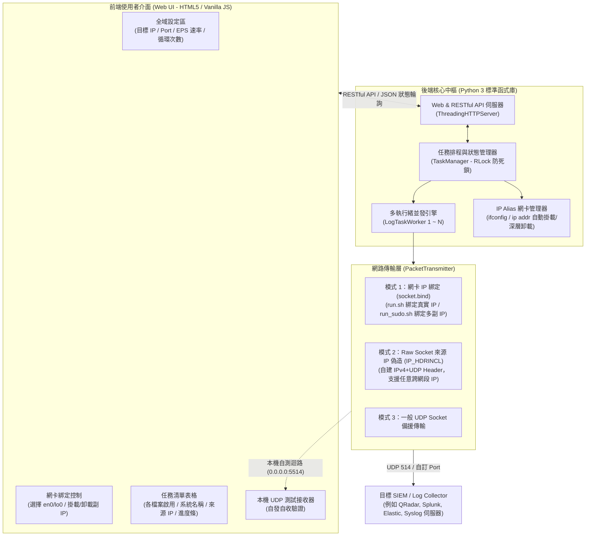

# Multi-Source Raw Log UDP 發送模擬器 (v2.0 零依賴 Web 版)

跨平台（支援 macOS / Linux / Windows）的現代化 Web 版 Log 模擬發送工具，專為 **SIEM / SOC / 日誌收集平台（Log Collector）** 驗證多系統來源、大量並發日誌串流與解析規則所設計。

---

## 🌟 核心特色

1. **100% 零第三方依賴 (Zero External Dependencies)**：
   - 全系統純使用 **Python 3 標準函式庫** 打造（內建 `http.server.ThreadingHTTPServer`、`socket`、`threading`、`struct`）。
   - **完全不需要執行 `pip install`**，免建置 `.venv` 虛擬環境，Clone 下來直接執行！
2. **純 Web 輕量架構，告別環境相容性問題**：
   - 以 `sudo` 執行時僅專注處理底層網路（IP Alias 掛載或 Raw Socket 偽造）與背景 HTTP 服務，完全不接觸 X11 / Wayland 圖形伺服器。
   - **支援無桌面 Linux 伺服器 (Headless Server)**：可在 Linux VM / Docker 容器背景啟動，透過筆電瀏覽器遠端連線操作 (`http://<主機IP>:8080`)。
3. **原生支援超大日誌檔案**：
   - 伺服器端直接讀取本機磁碟，支援數百 MB 甚至 GB 級別的 Raw Log 檔案原地發送，**不需要透過瀏覽器上傳**。
4. **雙權限執行模式，流暢切換**：
   - **一般權限模式 (`./run.sh`)**：動態綁定所選網卡的真實 IP，安全自測，保證不覆蓋多來源 IP 配置。
   - **管理員權限模式 (`sudo ./run_sudo.sh`)**：完整支援**網卡虛擬副 IP (IP Alias)** 自動掛載與 **Raw Socket 偽造**，真正模擬多台主機獨立來源 IP。

---

## 🏗️ 系統架構



---

## 🚀 快速啟動

請確保系統安裝有 Python 3.8 或以上版本（macOS / Linux 皆已內建）：

### 1. 管理員權限啟動（推薦：完整啟用多來源 IP 模擬）
若需要為每個 Log 檔案模擬獨立的來源 IP（如 `192.168.10.101` ~ `104`）：
```bash
sudo ./run_sudo.sh
```
> **提示**：系統將自動開啟瀏覽器前往 `http://127.0.0.1:8080`，頂端呈現綠色 Root 授權橫幅。

### 2. 一般權限快速啟動（免密碼，使用本機實體網卡 IP 發送）
若只需快速驗證日誌內容或測試本機接收流程：
```bash
./run.sh
```
> **提示**：頂端呈現藍色一般權限橫幅，所有任務自動鎖定並使用您所選網卡的真實 IP。

### 3. 進階啟動參數
```bash
# 指定監聽 Port (預設 8080)
python3 main.py --port 9000

# 允許區網其他電腦連線操作 (Headless Linux 伺服器推薦)
python3 main.py --host 0.0.0.0 --port 8080

# 啟動時不自動彈出桌面瀏覽器
python3 main.py --no-browser

# 啟動時自動載入指定的 Profile 設定檔
python3 main.py --profile my_test_profile.json
```

---

## 📖 操作方式詳細說明 (Operation Guide)

Web 介面採用單頁式直覺排版，以下為各功能區塊的詳細操作步驟：

### 一、頂端權限提示橫幅
- **綠色橫幅 (`Root / Sudo`)**：目前具備管理員權限，可使用網卡副 IP 自動掛載與 Raw Socket 偽造來源 IP。
- **藍色橫幅 (`一般使用者權限`)**：以一般權限執行，表格內來源 IP 自動鎖定為所選實體網卡之真實 IP，安全防呆。

---

### 二、全域發送設定區 (Global Configuration)
設定所有 Log 檔案發送時的預設行為（各任務仍可針對 Port/重複次數/EPS 個別覆寫）：

| 設定欄位 | 說明 | 範例 / 預設值 |
| :--- | :--- | :--- |
| **全域目標 IP** | 接收 Log 的伺服器 IP（SIEM 或本機接收器） | `127.0.0.1` 或 `192.168.1.50` |
| **全域目標 Port** | 預設接收 UDP 連接埠 | 預設 `514`（本機自測建議改為 `5514`） |
| **預設重複次數** | 每個檔案發送的輪數 | `1`（填寫 `1` 代表發送完該檔案所有行數即停止） |
| **無限循環發送** | 勾選後將持續循環發送該檔案，直到手動點擊停止 | 預設關閉 |
| **循環間隔 (秒)** | 多輪發送時，每一輪之間的暫停休息時間 | 預設 `1.0` 秒 |
| **全域速率 (EPS)** | 每秒發送筆數上限 (Events Per Second)；設為 `0` 為全速不限速 | 預設 `100` EPS |
| **發送模式** | 選擇底層發送技術：<br>• `auto`：自動最佳化（本機有 IP 即 bind，無則 Raw 偽造）<br>• `ip_alias_bind`：強制使用網卡副 IP 綁定（推薦）<br>• `raw_spoof`：強制使用 Raw Socket 偽造<br>• `standard_udp`：一般 UDP Socket | 預設 `auto` |
| **附加標準 Syslog 表頭** | 自動在每行日誌開頭加上 RFC 3164 表頭：`<134>MMM DD HH:MM:SS <來源IP>` | 預設關閉（原樣發送） |
| **結束自動清理副 IP** | 任務停止或退出程式時，自動卸載掛載的虛擬副 IP | 預設開啟（強烈建議開啟） |

---

### 三、網卡綁定與虛擬副 IP 工具列 (IP Alias Toolbar)
位於全域設定下方，專門管理本機網路卡與多 IP 模擬：

1. **🔌 綁定網卡下拉選單**：
   - 系統啟動時會自動偵測本機所有網卡（例如 `en0 (192.168.2.101)`、`lo0 (127.0.0.1)`）。
   - 在一般權限下切換網卡，下方任務清單的來源 IP 會**即時聯動更新**為該網卡的真實 IP。
2. **🔄 重新整理網卡**：隨時重新讀取系統最新網卡狀態與 IP。
3. **🔗 一鍵掛載清單內虛擬副 IP** *(需 sudo)*：
   - 掃描目前任務表格中所有啟用的「來源 IP」，自動在選定的網卡上執行 `ifconfig <iface> alias <ip>` 或 `ip addr add`。
4. **🧹 一鍵清除虛擬副 IP** *(需 sudo)*：
   - 即刻卸載所有由本程式掛載的虛擬副 IP，保持網卡環境乾淨。
5. **🔢 批次自動遞增分配來源 IP** *(需 sudo)*：
   - 點擊後彈出對話框，預設會以第一個任務的 IP（或網卡網段）為起始點。
   - 輸入起始 IP（如 `192.168.10.101`）後按確認，系統會由上而下自動遞增為各個任務分配 `.101`、`.102`、`.103`、`.104`... 不重複來源 IP。

---

### 四、多任務清單管理表格 (Task Table)
每個列代表一個獨立的 Raw Log 檔案發送任務：

- **選取複選框**：點擊勾選/取消該檔案；表頭具備 **「全選 / 取消全選」** 功能。
- **系統名稱 (System Name)**：識別日誌所屬系統（例如 `PaloAlto-FW`, `Linux-SSHD`, `WinEvent`, `Nginx`）。
- **Log 檔案路徑**：顯示檔案路徑。**點擊藍色檔案路徑**可在下方即時預覽檔案前 50 行內容與編碼格式。
- **總行數**：系統自動統計該檔案的有效日誌行數（自動排除空行）。
- **來源 IP (Source IP)**：
  - **在 `run_sudo.sh` 下**：可自由編輯任意 IP（如 `192.168.10.101`），支援點擊上方「批次自動遞增」。
  - **在 `run.sh` 下**：自動顯示為所選網卡的真實 IP（如 `192.168.2.101 (綁定 en0)`），欄位呈現灰色防呆，且**絕對不會覆蓋破壞**原有已設定的多來源 IP 數值。
- **個別 Port / 重複次數 / EPS**：若留空則套用全域設定；填寫數值則覆寫該檔案之發送參數。
- **當前輪數與總發送筆數**：即時顯示目前執行第幾輪（如 `第 1/1 輪 (850 筆)`）。
- **發送進度條**：以百分比平滑呈現發送進度。
- **狀態標籤**：呈現 `就緒`、`發送中`、`已暫停`、`已完成` 或 `錯誤`。
- **操作 (✕)**：將該任務從清單中移除。

---

### 五、檔案管理與任務控制列
- **📄 加入 Raw Log 檔案**：點擊開啟伺服器端檔案瀏覽器，可直接選取本機磁碟任何目錄下的日誌檔加入清單。
- **📂 掃描 sample_logs/ 目錄**：自動將專案內 `sample_logs/` 目錄中的範例日誌（防火牆、SSHD、Windows、Web）一鍵匯入。
- **🧹 清除未勾選任務**：一鍵清理未啟用的任務行。
- **▶ 啟動全部任務**：將所有勾選啟用的任務同時並發發送。
- **⏸ 暫停全部 / 繼續發送**：發送過程中可隨時瞬間凍結發送，再次點擊繼續。
- **⏹ 停止全部任務**：立即中止所有執行緒發送。
- **💾 儲存為設定檔 / 📂 載入設定檔**：將目前所有全域設定與任務清單匯出為 `.json` 格式，或載入先前存檔。

---

### 六、內建本機 UDP 測試接收器 (Local UDP Receiver)
頁面底部提供專門的本機自測工具：
1. 點擊 **「📡 啟動本機 UDP 接收器」**，後端將在背景監聽 `0.0.0.0:5514`。
2. 將任務清單或全域目標 Port 設為 `5514`，目標 IP 設為 `127.0.0.1`。
3. 點擊「▶ 啟動全部任務」，接收器視窗將即時跳出收到的封包，並清楚打印來源 IP 與 Port：
   ```text
   [#1 | 09:30:15 | 來自 192.168.2.101:54321] <134>Oct 21 09:30:15 192.168.2.101 CEF:0|Palo Alto Networks|...
   ```
4. 驗證完畢後點擊「⏹ 停止接收器」即可關閉監聽。

---

## ⚖️ 兩種模式行為對照表

| 比較維度 | 一般權限模式 (`./run.sh`) | 系統管理員模式 (`sudo ./run_sudo.sh`) |
| :--- | :--- | :--- |
| **適用場景** | 本機快速除錯、驗證日誌格式、無 root 伺服器 | 正式多系統來源 IP 模擬、SIEM 規則測試 |
| **執行權限** | 一般使用者 (UID != 0)，免密碼 | 需要 root 權限 (UID == 0) |
| **底層 Socket 技術** | 標準 UDP Socket 綁定 (`sock.bind`) | IP Alias 網卡綁定 + Raw Socket 偽造 |
| **來源 IP 表現** | 固定使用**當前選定網卡的真實 IP** (如 en0: `192.168.2.101`) | **每個檔案獨立使用不同來源 IP** (如 `.101`, `.102`) |
| **表格欄位狀態** | 來源 IP 呈灰色唯讀禁用，自動跟隨網卡連動 | 來源 IP 允許自由編輯，支援批次自動遞增 |
| **設定檔保護** | 100% 保留多 IP 配置，不覆蓋原有設定 | 讀取並寫入各檔案自訂來源 IP |
| **網卡虛擬副 IP** | 不掛載副 IP，無網卡修改動作 | 自動在選定網卡上掛載虛擬副 IP 陣列 |
| **自動清理機制** | 無需清理網卡 | 停止、完成、或按 `Ctrl+C` 時**徹底自動卸載清理** |

---

## 🧪 典型測試情境 SOP 示範

### 情境 1：5 分鐘本機快速自發自收驗證 (免 Sudo)
1. 終端機執行 `./run.sh`，瀏覽器自動開啟。
2. 點擊「📂 掃描 sample_logs/ 目錄」，匯入 4 個範例日誌。
3. 頁面下方點擊「📡 啟動本機 UDP 接收器」（監聽 Port 5514）。
4. 在全域設定將「全域目標 Port」改為 `5514`，「目標 IP」維持 `127.0.0.1`。
5. 點擊「▶ 啟動全部任務」，觀察日誌視窗與下方接收器即時跳出收到的封包。

### 情境 2：正式向遠端 SIEM 發送 4 種系統來源 IP (需 Sudo)
1. 終端機執行 `sudo ./run_sudo.sh`。
2. 在全域設定輸入遠端 SIEM 收集器 IP（例如 `192.168.1.50`），目標 Port 設為 `514`。
3. 在「🔌 綁定網卡」下拉選單選取與 SIEM 同網段的實體網卡（例如 `en0`）。
4. 點擊「🔢 批次自動遞增分配來源 IP」，起始 IP 設定為 `192.168.1.201`，點擊確認。
5. （選配）點擊「🔗 一鍵掛載清單內虛擬副 IP」手動預先掛載（或直接啟動，後端會自動掛載）。
6. 點擊「▶ 啟動全部任務」，SIEM 即會接收到來自 `192.168.1.201` ~ `204` 的 4 種獨立設備日誌！
7. 測試結束後點擊停止或終端機按下 `Ctrl+C`，系統自動卸載所有副 IP。

---

## ❓ 常見問題排查 (FAQ)

### Q1: 在 macOS 上執行 `sudo ./run_sudo.sh` 提示無法卸載 IP？
> 本系統採用深層卸載指令 `ifconfig <interface> -alias <ip>`，無論透過介面「一鍵清除」、任務停止、或終端機中斷（`Ctrl+C`），後端皆有註冊信號處理器保證 100% 清理乾淨。若需手動檢查，可執行 `ifconfig en0` 確認已無 alias。

### Q2: 發送速度是否能達到極高吞吐量 (High EPS)？
> 可以。後端採用獨立執行緒並發架構與高精度時間權杖（Time Token Bucket）機制。若將 EPS 設為 `0`（不限速），本機 UDP 發送輸送量可輕鬆超越每秒數萬筆。

### Q3: 為什麼在 `run.sh` 模式下無法編輯來源 IP？
> 因為在無 root 權限下，作業系統不允許隨意偽造封包 IP 或建立虛擬網卡別名。為了避免使用者誤以為封包能發出該模擬 IP，系統主動將欄位灰階保護，並動態綁定網卡的真實 IP；如需多來源 IP 請改用 `sudo ./run_sudo.sh`。

---

## 📄 專案目錄結構

```text
log 模擬測試/
├── main.py                 # 程式主進入點 (CLI 解析、信號攔截、自動開瀏覽器)
├── run.sh                  # 一般權限快速啟動腳本
├── run_sudo.sh             # 管理員權限啟動腳本 (啟用多來源 IP 模擬)
├── requirements.txt        # 零外部依賴聲明文件
├── default_profile.json    # 預設範例專案設定檔
├── sample_logs/            # 內建 4 種標準 Raw Log 範例
│   ├── paloalto_traffic.log
│   ├── linux_sshd.log
│   ├── windows_security.log
│   └── nginx_access.log
├── core/                   # 後端核心模組
│   ├── models.py           # 資料模型與輔助驗證函式
│   ├── ip_alias_manager.py # 跨平台網卡偵測與副 IP 掛載/卸載引擎
│   ├── packet_sender.py    # 網路封包層 (Socket 綁定 / Raw Socket 偽造)
│   ├── worker.py           # 多執行緒 Worker 與本機 UDP 測試接收器
│   └── task_manager.py     # 執行緒安全任務中樞 (RLock 防死鎖)
└── web/                    # 現代化前端與 Web 服務
    ├── server.py           # 輕量非同步 HTTP & RESTful API 伺服器
    └── index.html          # 單頁響應式現代深色 Web UI (HTML5 + Vanilla JS)
```
